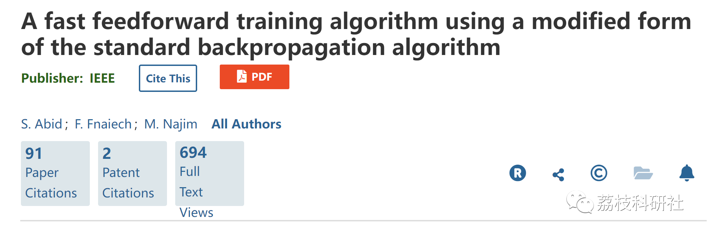
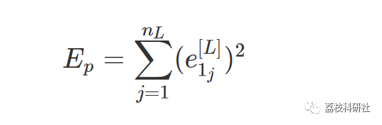
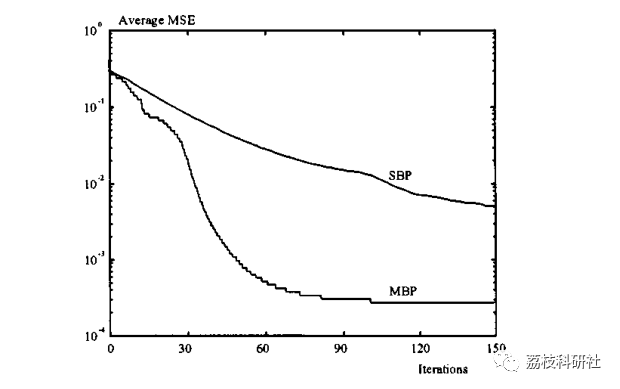
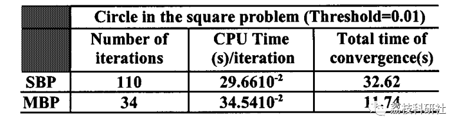
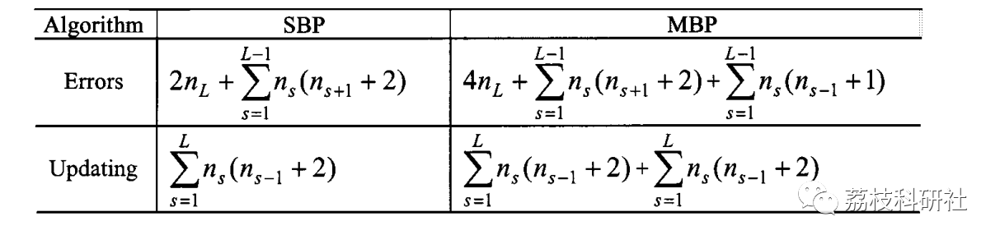

# Improved Backpropagation Neural Network Algorithm Based on Standard Backpropagation Algorithm (Matlab Code Implementation)

💥💥💥💞💞💞 Welcome to this blog❤️❤️❤️ 💥💥💥
🏆 Bloggers' Advantages: 🌞🌞🌞 The content of the blog strives for rigorous thinking and clear logic to facilitate readers.
⛳️ Mantra: "Those who travel a hundred miles may arrive at ninety-nine."
Litchi Research Society
Code Collection: Power Systems, Intelligent Algorithms and Applications, Neural Network Prediction, Path Planning, Optimized Scheduling, Workshop Scheduling, Image Processing, Signal Processing...
🎁 Special Section Links:
🌈🌈🌈🌟🌟🌟🌟 Electrical Code Intelligent Algorithms and Their Applications Path Planning Neural Network Prediction Optimized Scheduling Image Processing Workshop Scheduling Signal Processing Romantic Her Thoughts My Philosophy Math Model Complete Code Issues
​
Source of literature, then reproduce it:
💥1 Overview
The SBP algorithm has become the standard algorithm for training multilayer perceptrons, as shown in Figure 1. It is a generalized least mean square (LMS) algorithm that minimizes the error squared between the actual output and the required output. This standard is:
Detailed article download link:
https://ieeexplore.ieee.org/document/914537
📚2 Run Results
W1W1 =
🎉4 References
[1] S. Abid, F. Fnaiech and M. Najim, "A fast feedforward training algorithm using a modified form of the standard backpropagation algorithm," in IEEE Transactions on Neural Networks, vol. 12, no. 2, pp. 424-430, March 2001, doi: 10.1109/72.914537.  
🌈4 MATLAB Code Implementation
Click the left bottom corner of this article to [Read Full Content]

## Images

<!-- PAYMENT_BLOCK -->

## Get this dataset

- Payment link (Stripe): [Buy now](https://buy.stripe.com/3cs8yP7sY87d0vu9AB)
- Payment QR code: 

<!-- /PAYMENT_BLOCK -->
